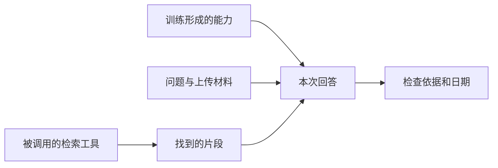

AI 的回答可能受到训练、当前对话材料和外部检索共同影响。它说出一项事实，并不代表它刚刚查过原始网页；你需要问清这次回答的依据从哪里来。

## 三个来源怎样分工

| 来源 | 作用 | 使用时要注意 |
|---|---|---|
| 训练 | 从数据形成语言和任务能力 | 不等于一份能逐条查阅的资料目录 |
| 当前材料 | 把问题、文档和示例放进此次输入 | 可能被截断、解析遗漏或误解 |
| 外部检索 | 从网页、文件或数据库找材料 | 可能搜错、过时或缺少重要片段 |

[Language Models are Few-Shot Learners](https://arxiv.org/abs/2005.14165) 展示了预训练语言模型与文本任务示例的作用；在输入中提供示例，不等于每次都对模型权重进行训练。[Retrieval-Augmented Generation for Knowledge-Intensive NLP Tasks](https://arxiv.org/abs/2005.11401) 则讨论将外部检索知识与生成结合。

不同产品不一定启用所有路径。有没有联网、资料是否真正被读取，要看功能说明和这次操作记录，不能只凭模型回答“我查到了”。

## 为什么它不能总给出出处

训练通常改变模型参数，输出一个内容时未必能可靠指出具体训练来源。当前材料中的引用比较容易追踪，但也可能被引用错。联网检索提供了原文入口，却仍需检查原文是否支持结论。

问一个虚构例子：“办公室下周何时搬迁？”如果你没提供通知，也没有授权它检索相应系统，回答具体日期就没有可靠依据。正确流程是提供正式通知或要求它说明资料不足。

## 什么时候一定要查最新资料

涉及价格、规则、产品功能、人员任职或活动日期时，知识可能已经改变。查看具体页面的发布和更新时间，再确认回答所说的是哪个版本、哪个地区和什么范围。

历史论文适合解释原理，却不能单独证明当前产品已具备某个功能。反过来，产品新增功能也不会让过去的研究结论自动适用于所有任务。

## 一个实用的提问方式

可以要求：“请区分哪些结论来自我提供的文件，哪些来自你实际检索到的页面；列出对应原文与日期；没有依据的部分保留为待确认。”这能把验证对象讲清楚。若系统不支持检索，就让它帮助列出需要查证的问题，而不是让它模拟查询结果。

## 分享摘要

AI 的依据可能来自训练、当前材料或外部检索。使用时分清这三条路径，尤其核对日期和原文；能够回答，并不表示它刚查过最新资料。

## 相关阅读

- [[怎样让AI根据资料回答并标出依据]]
- [[上下文与长期记忆有什么区别]]

## 来源与核验

查询日期：2026-10-06。下列资料支持基础机制和方法；本文任务材料、提示词与参考答案为作者编写的教学演示。论文结论仅对应其被测任务与模型。

- [Language Models are Few-Shot Learners](https://arxiv.org/abs/2005.14165)：2020年原始论文；预训练语言模型与文本中的任务示例，不等同于验证事实。
- [Retrieval-Augmented Generation for Knowledge-Intensive NLP Tasks](https://arxiv.org/abs/2005.11401)：2020年原始论文；检索外部知识与生成结合，不保证所有回答正确。
