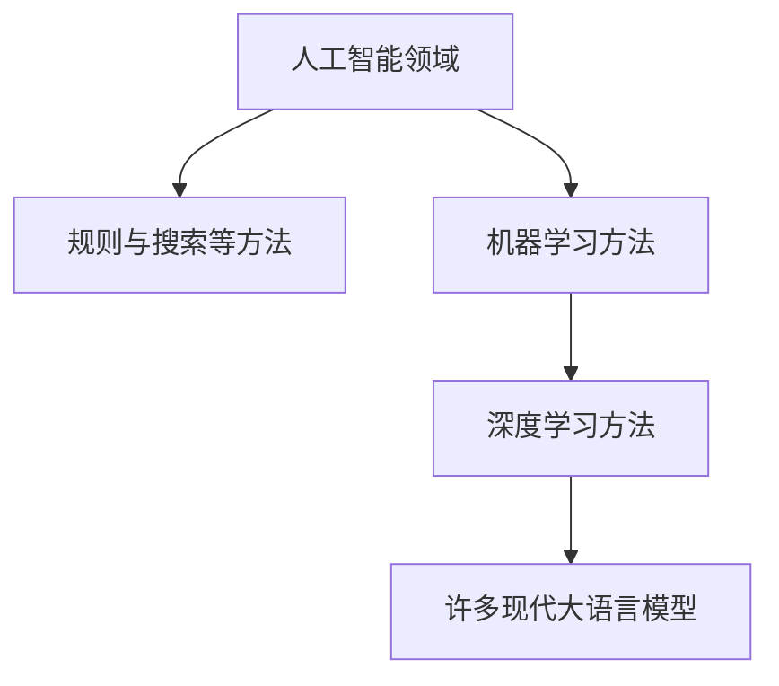

AI 是一个较宽的研究与应用范围，机器学习是一类从数据中学习规律的方法，大模型描述的是模型规模和能力的一类实践。三者不能直接画成三个同义词。

## 从同一个分类任务看差别

假设要把邮件分成“会议”“资料”和“其他”。以下是教学设计例子。

规则程序可以规定：标题有“会议”就进入会议类。它容易检查，但标题换成“周四讨论”就可能漏掉。机器学习方法则可以从标注过的邮件学习判断方式；标注、数据分布与错误类型会影响结果。[What is machine learning?](https://developers.google.com/machine-learning/intro-to-ml/what-is-ml) 介绍了这种由数据学习的基本思路。

语言模型还可以接收一段任务说明和几个分类例子，再尝试处理新邮件。[Language Models are Few-Shot Learners](https://arxiv.org/abs/2005.14165) 展示了文本说明和少量示例下的任务能力。这让使用更灵活，但不意味着分类结果无需检查，更不意味着它知道你的组织规则。

图中表示常见方法关系，不是完整学术分类；现代系统可以把多个方法组合使用。

## 大模型为什么能处理不同任务

许多现代语言模型建立在深度神经网络上，训练时接触大量文本，使用时根据输入组织输出。[Attention Is All You Need](https://arxiv.org/abs/1706.03762) 提出了Transformer架构，为理解许多后续语言模型提供技术起点；不能据此说所有AI都采用Transformer。

“大”也不是一个跨领域固定参数门槛。模型参数、训练数据、任务和后训练方式共同影响能力。参数更多，不会自动证明它更懂某个行业，也不一定是你的任务中成本最低的选择。

## 普通用户需要分清什么

| 听到的说法 | 更有用的追问 |
|---|---|
| 这是一个AI工具 | 它具体完成哪项任务？ |
| 用了大模型 | 如何检查输出和处理错误？ |
| 它在数据上训练过 | 数据是否适合我的场景？ |
| 它能自动执行 | 有哪些权限和停止条件？ |

同一个产品可以用语言模型理解说明、规则程序检查格式、数据库保存结果。评价时关注整个任务是否完成，而不是只看其中某个组件的名字。

入门时先选择一项小任务，观察输入、输出和错误，再逐步学习背后的技术。你无需先掌握全部数学，才能开始判断AI对工作是否有帮助；但了解这些概念，可以减少把宣传用语当作能力证明的风险。

## 分享摘要

AI、机器学习和大模型并非同义词。理解它们的关系，最终是为了看清一个工具完成什么任务、如何检查结果，以及哪些能力只是宣传中的概括。

## 相关阅读

- [[AI从哪里获得知识]]
- [[AI为什么会编造答案]]

## 来源与核验

查询日期：2026-10-06。下列资料支持基础机制和方法；本文任务材料、提示词与参考答案为作者编写的教学演示。论文结论仅对应其被测任务与模型。

- [What is machine learning?](https://developers.google.com/machine-learning/intro-to-ml/what-is-ml)：Google官方课程；机器学习由数据学习规律的基本定义。
- [Attention Is All You Need](https://arxiv.org/abs/1706.03762)：2017年原始论文；注意力与Transformer架构，不据此断言所有AI均采用该架构。
- [Language Models are Few-Shot Learners](https://arxiv.org/abs/2005.14165)：支持任务说明与少量文本示例的使用方式，不能作为本例分类结果正确的保证。
