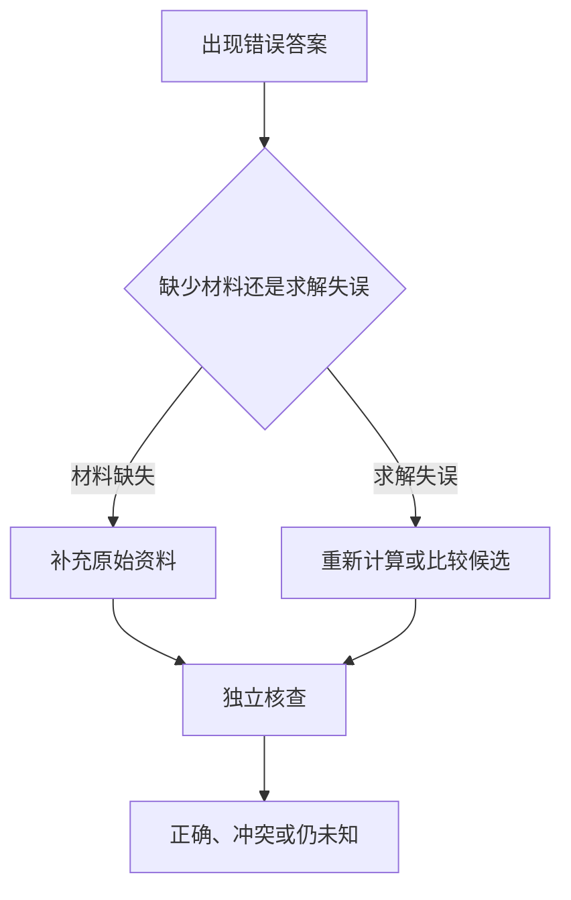

AI 花更久生成答案，有时能完成更多检查，但等待时间本身不是正确性的证据。先判断任务缺的是计算、材料还是可靠的验证方法，才能决定多算一次是否有用。

## 同一问题，多算一次可能改变什么

假设要检查一张收支表。AI 可以重算总额、换一种计算顺序或生成多个候选，再对照原始数字。多做步骤有机会发现漏项；如果原表漏了一个账户，再长的计算也不能知道漏掉的金额。这是作者设计的教学例，不是某产品的测试结果。

推理预算可能花在更长的步骤、并行候选或验证后选择上。界面等待时间还受网络、服务负载和工具调用影响，不能直接用等待秒数衡量推理质量。

## 研究说明了什么

关于测试期计算的研究比较了不同策略，并发现收益与题目难度有关。DeepSeek-R1 的研究说明强化学习可以在被测任务上激发推理行为。两项证据支持“策略与训练可能改善求解”，不支持“想得久就一定答对”。

## 为什么反复检查仍可能重复错误

多个候选可能共享同一错误假设。让同一个模型给自己的答案打分，也可能重复原来的判断。形式上写出“已验证”不代表查过资料或执行过计算；应要求提供能够外部复核的过程产物。

更长输出还可能加入新的无依据细节。需要的是与问题相关的检查，不是无限增加解释长度。

## 怎样使用更高的思考预算

先锁定输入与成功条件，例如“按这张表核对总额，并列出不一致的行”。要求区分原始数字、计算结果和材料未提供的事项。数字用独立计算复核；事实结论回到原文；代码看测试输入和实际输出。

如果只是换一种表达，不必默认使用最高预算。复杂任务可以比较普通和较高预算的结果，但要固定材料与评价标准，记录修正次数和耗时。本篇没有产品对比或省时比例。

## 自查练习与边界

给出两组数字，让AI汇总，再自己计算。然后故意移除一个字段，观察它是否说明信息不足。正确的求解应与未知项并存，不应为补齐表格而猜测。

## 分享摘要

更长思考可能改善求解，却不能补齐缺失事实，也不能替代独立验证。遇到错误先分清材料不足还是计算失误，再决定补资料、增加预算或更换检查方法。

## 相关阅读

- [[AI为什么会编造答案]]
- [[如何检查AI回答的事实和引用]]

## 来源与核验

核对日期：2026-10-09。来源支持范围见下列说明；本文解释与教学例不构成论文复现或产品实测。

- [Scaling LLM Test-Time Compute Optimally can be More Effective than Scaling Model Parameters](https://arxiv.org/abs/2408.03314)：2024年；测试期计算策略的效果依赖题目难度与验证方式。
- [DeepSeek-R1: Incentivizing Reasoning Capability in LLMs via Reinforcement Learning](https://arxiv.org/abs/2501.12948v1)：2025年v1；强化学习、可验证任务与推理行为的实验范围。
