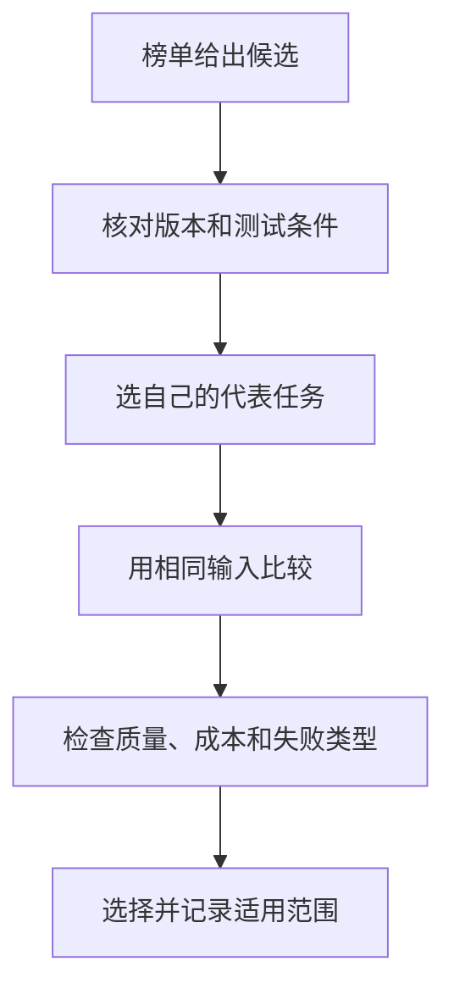

排行榜能提供线索，但不能直接替你选择工具。首先看它测量的是哪一种能力、哪一个版本，以及这个任务和你的实际需要有多接近。

## 分数背后的问题

有的榜单测标准答案是否正确，有的测代码能否通过测试，有的让人比较两段回答更喜欢哪一段。指标不同，分数高低回答的问题也不同。

[Holistic Evaluation of Language Models](https://arxiv.org/abs/2211.09110) 提出多个场景与评价维度的整体评估。[Chatbot Arena: An Open Platform for Evaluating LLMs by Human Preference](https://arxiv.org/abs/2403.04132) 研究基于人类偏好的模型比较；喜欢某个回答，不一定表示它的每个事实都正确，也不表示它在另一项任务上更好。

## 看榜单时至少读这些说明

| 项目 | 为什么需要 |
|---|---|
| 模型与日期 | 同名产品可能换过版本 |
| 基准及版本 | 不同数据集和题目难度不能直接混比 |
| 工具与提示条件 | 是否联网、运行代码或多次尝试会影响结果 |
| 成本与延迟 | 更高分可能伴随更长时间或更多资源 |
| 不确定性和样本 | 小差异可能不稳定，覆盖范围可能有限 |

比较时不能把较新版本的某一分数与另一模型较旧条件的分数拼成统一排名。厂商自报数据也应保留出处，与独立评测分开。

## 怎样做一个小范围选择

如果主要工作是资料摘要，可以选三份允许使用的材料：一份短文、一份有数字和否定的记录、一份多版本文档。用相同要求测试，分别检查忠实性、漏项和复核负担。

这个小样本只用于你的初步选择，不足以发布成“全球最强模型”的结论。真实任务改变之后，还应重新比较。也不要为了一个分数忽略数据使用范围、使用门槛和维护需求。

模型选择最终是任务选择。知道自己必须保留哪些事实、允许什么错误、需要怎样的速度，往往比记住排行榜第一名更能帮助你用好AI。

## 分享摘要

排行榜首先告诉你“在什么条件下测到了什么”，并不直接告诉你哪款工具最适合工作。核对版本，再用自己的代表任务比较质量、成本和复核负担。

## 相关阅读

- [[推理延迟和成本怎样计算]]
- [[如何检查AI回答的事实和引用]]

## 来源与核验

查询日期：2026-10-06。下列资料支持基础机制和方法；本文任务材料、提示词与参考答案为作者编写的教学演示。论文结论仅对应其被测任务与模型。

- [Holistic Evaluation of Language Models](https://arxiv.org/abs/2211.09110)：2022年HELM论文；模型评价需多个场景和维度。
- [Chatbot Arena: An Open Platform for Evaluating LLMs by Human Preference](https://arxiv.org/abs/2403.04132)：2024年原始论文；基于人类偏好的比较评价，不等于每项任务的客观准确性。
