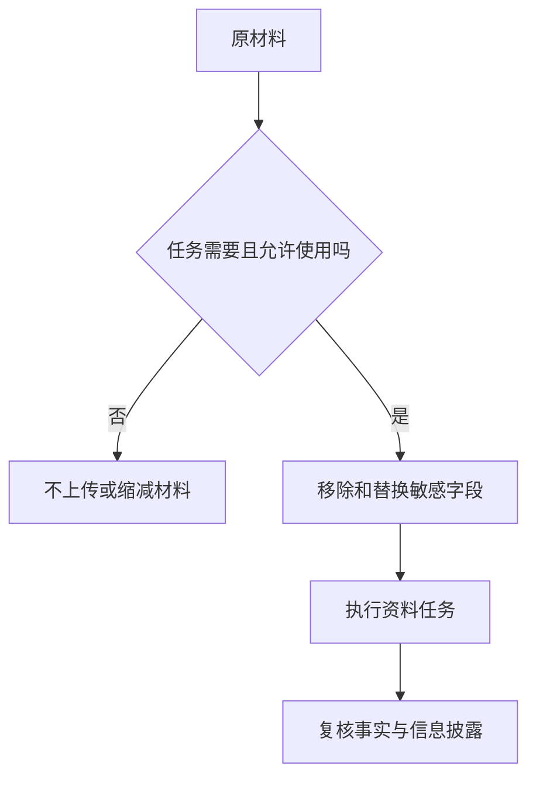

上传前先判断资料能否交给所用系统，使用结果前再判断回答是否准确。脱敏和事实复核是两项工作，做好其中一项不会自动完成另一项。

## 输入前：先限定用途

假设你只需要改写一封通知邮件，通常不需要上传完整通讯录或整份合同。先删去任务不需要的内容，再替换必要的身份标识，能让输入更容易检查。

以下是模拟示例，不含真实个人信息：

| 原始教学文本 | 可供练习的替换文本 |
|---|---|
| 甲的联系电话为一个虚构号码 | 联系人A，联系方式省略 |
| 某客户申请一项独特服务 | 客户A申请服务类别X |
| 包含精确地址和时间的记录 | 仅保留任务需要的地区或时间范围 |

具体保留范围由任务与组织要求决定。仅把姓名改成A，也可能通过独特事件、职位或精确时间重新识别人物，不能称为彻底匿名化。

## 一个可执行的顺序

1. 明确这次任务需要哪些字段。
2. 确认系统和账号是否允许处理这类资料。
3. 移除不必要内容，替换标识，自己复读一次。
4. 提供清楚的任务与输出约束。
5. 对结果检查事实、引用，以及是否重新出现不该展示的信息。

[NIST AI 600-1 Generative AI Profile](https://www.nist.gov/publications/artificial-intelligence-risk-management-framework-generative-artificial-intelligence) 提供生成式AI可信使用和评估的风险管理框架。[OWASP LLM01:2025 Prompt Injection](https://genai.owasp.org/llmrisk/llm01-prompt-injection/) 说明外部资料可能夹带指令；“这是来自文档的文字”不应变成新的操作授权。

## 输出后：看两个不同问题

第一，是否忠实于资料？例如把8条完成变成12条完成，需要修正。第二，是否把输入中的身份、凭据或私人信息带入了输出？即使事实正确，也可能不适合分享。

如需要恢复姓名等标识，应在受控本地材料中完成，替换对应表不与公开稿一起发布。模型是否保留输入、保存多久、是否用于训练，要查所用产品及组织配置，本文不替任何平台作统一承诺。

本流程是教学方法，不构成对某次上传的合规认定。拿不准使用范围时，先处理公开或模拟材料；得到授权和明确配置后，再扩展到真实工作资料。

## 分享摘要

上传前检查使用范围并减少输入，输出后检查事实和信息披露。替换姓名不一定等于匿名化；敏感资料是否可用，要结合任务、平台配置与组织要求判断。

## 相关阅读

- [[怎样让AI根据资料回答并标出依据]]
- [[邮件润色怎样保留事实和承诺]]
- [[提示注入与工具权限怎样分工]]

## 来源与核验

查询日期：2026-10-06。下列资料支持基础机制和方法；本文任务材料、提示词与参考答案为作者编写的教学演示。论文结论仅对应其被测任务与模型。

- [NIST AI 600-1 Generative AI Profile](https://www.nist.gov/publications/artificial-intelligence-risk-management-framework-generative-artificial-intelligence)：NIST 2024风险管理报告；生成式AI的评估与可信使用框架。
- [OWASP LLM01:2025 Prompt Injection](https://genai.owasp.org/llmrisk/llm01-prompt-injection/)：OWASP风险条目；直接和间接提示注入及防护边界。
