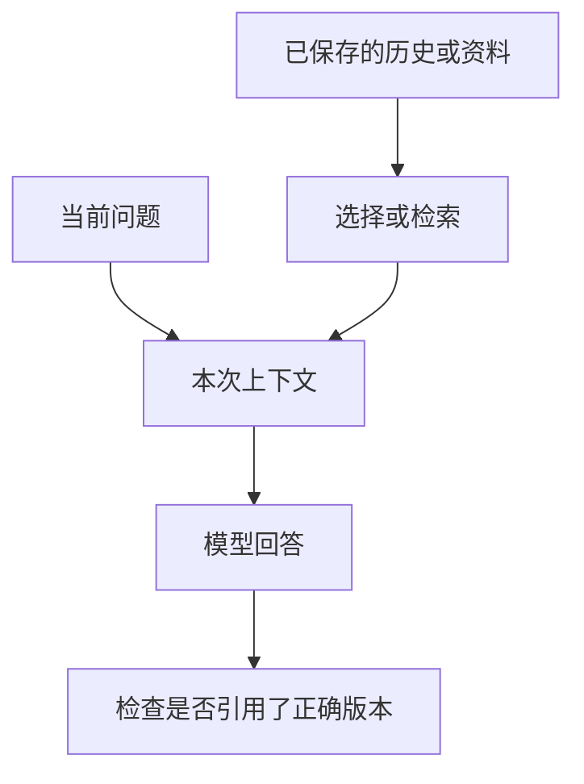

上下文是系统这次交给模型的内容，长期记忆通常是另外保存并按需取回的信息。聊天记录仍在界面里，不代表模型每次都完整读到了它。

## 用一份会议材料理解

你今天上传会议记录并请它总结，这份文本可能进入本次上下文。下周再问“上次决定了什么”，系统可能重新加载记录、检索摘要，也可能根本没有把相关内容交给模型。

因此，“忘记”不一定是模型把一件事删除了。也可能是材料没有保存、没有被选入输入、查询没匹配到，或者保存的摘要丢掉了关键限制。这个例子是解释系统分工，不描述某款产品的具体实现。

[Retrieval-Augmented Generation for Knowledge-Intensive NLP Tasks](https://arxiv.org/abs/2005.11401) 提供了从外部知识取回材料的一个研究路径。实际记忆系统还可能使用规则、数据库和摘要；不能把所有记忆功能都等同于向量检索。

## 窗口很长，也需要组织

能接收更多内容，表示输入容量增加，不代表模型对每个位置的信息都同样稳定。[Lost in the Middle: How Language Models Use Long Contexts](https://arxiv.org/abs/2307.03172) 在被测模型和任务中发现了信息位置影响表现的现象。这提示我们检查重点材料是否被正确利用，而不是为所有模型指定固定位置规则。

长文处理时，可以先列来源版本、问题范围和相关段落，再请求回答。摘要要保留否定、条件、数字和未完成状态；只保存一句“项目进展顺利”，未来就很难还原4条需求待确认的事实。

## 使用前应该问什么

- 保存的是原文、摘要还是偏好？谁可以访问？
- 当前回答究竟读取了哪一份记录？是否有日期和版本？
- 修改或删除资料之后，索引和摘要是否同步更新？
- 产品是否提供导出、纠错和关闭记忆功能？

这些答案取决于产品和配置，不能从模型口头承诺推断。重要事项仍应保存在你能够查看和维护的记录中。

对于普通使用，最可靠的做法是给本次任务提供必要材料，让回答指出依据，发现旧版本时明确更正。长期记忆可以降低重复说明的负担，但不应该成为你唯一的事实台账。

## 分享摘要

长上下文和长期记忆是不同能力。前者关注这次交给模型的内容，后者关注保存和取回；重要任务要查看实际使用的材料和版本，而不是只看聊天记录还在不在。

## 相关阅读

- [[AI从哪里获得知识]]
- [[上下文怎样组织才便于核对]]

## 来源与核验

查询日期：2026-10-06。下列资料支持基础机制和方法；本文任务材料、提示词与参考答案为作者编写的教学演示。论文结论仅对应其被测任务与模型。

- [Lost in the Middle: How Language Models Use Long Contexts](https://arxiv.org/abs/2307.03172)：2023年原始论文；被测模型对长上下文中信息位置敏感，不是所有模型的固定规律。
- [Retrieval-Augmented Generation for Knowledge-Intensive NLP Tasks](https://arxiv.org/abs/2005.11401)：2020年原始论文；检索外部知识与生成结合，不保证所有回答正确。
