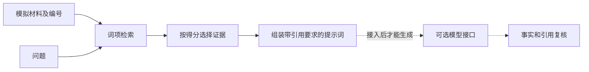

一个检索增强问答流程至少要把“找依据”和“写答案”分开。我们用很小的办公材料做示例，使检索结果可以手工核对，而不是从复杂框架配置开始。

## 本例实现了什么

`03-AI工具与工作流/AI办公实践/examples/minimal_rag.py` 使用 Python 标准库，读取同目录 `office_materials.json`，用中文相邻双字片段及英文词项计算重合度，然后取最高分材料组装提示词。

它没有安装嵌入模型、向量库，也没有调用大模型。输出是检索命中与待发送提示词，不是AI生成的最终答案。名称中的RAG表示流程教学，检索器本身只是词项基线。

[Retrieval-Augmented Generation for Knowledge-Intensive NLP Tasks](https://arxiv.org/abs/2005.11401) 给出检索与生成结合的原始模型方法。本例借用流程分工，不能据此声称复现了论文架构或性能。



## 从仓库根目录运行

```powershell
python "03-AI工具与工作流/AI办公实践/examples/minimal_rag.py" --query "需求归类情况" --top-k 1
```

输出中的首个命中应为D1，原文含“12条需求”“8条已归类”“4条待确认”。再用“报告提纲审核情况”提问，首个命中应为D2。运行结果记录在本地验收报告；这些查询只是功能样例，不构成统计意义上的检索准确率。

## 生成接口需要怎样约定

函数 `build_prompt(query, hits)` 返回字符串，包含问题、材料编号和引用要求。后续接入可用 `generate(prompt: str) -> str` 适配模型客户端。API密钥从环境或受控配置读取，不进入笔记、样例或日志。当前示例未提供在线客户端，也没有计费调用。

调用前应记录模型版本、检索器版本、材料版本与参数；调用后保留原始输出，再分开评估命中材料是否相关以及回答是否受到支持。接入接口不是把系统自动升级为生产可用。

## 失败为什么不能只看最后答案

词项相似不等于语义正确，否定句也可能得高分。“需求归类”与“需求分类”可能因为表达不同而漏检；文档太长则可能把无关段落一起带入。[Lost in the Middle: How Language Models Use Long Contexts](https://arxiv.org/abs/2307.03172) 对被测模型报告了长上下文位置敏感性，说明塞入更多文本不能当作通用修复方法。

`top-k` 必须为正，空问题报错，无命中输出“材料未提供”，不能悄悄调用模型知识补全。下一步升级应从失败样本出发，比较分块、词项检索、向量检索和重排序，而不是在没有基线时先增加组件。

## 完整附件与失败输入

本篇公开附件为脚本及其输入材料，路径保持一致：

- `03-AI工具与工作流/AI办公实践/examples/minimal_rag.py`
- `03-AI工具与工作流/AI办公实践/examples/office_materials.json`

下载独立分享仓库后，在其根目录运行上述命令。材料与脚本保持同目录；直接复制一篇文章而没有这两份附件，不能完整运行。

把query改为英文`budget`，当前材料应无命中；空query或top-k为0应非零退出。对“需求归类”和“需求分类”分别提问，观察词项改变怎样影响排序，再回到原文判断相关性。检索分数是字符片段重合度，不是置信概率。

记录问题、检索命中、组装提示词和材料版本，能定位错误来自漏检还是后续生成。当前没有在线模型、密钥、计费调用或生产评测。

## 分享摘要

最小 RAG 教学例把检索和生成分开：先找带编号的材料，再组装提示词，最后复核回答。本例实际运行词项检索，未调用大模型，也不能当作完整生产RAG系统。

## 相关阅读

- [[怎样让AI根据资料回答并标出依据]]
- [[如何检查AI回答的事实和引用]]
- [[上下文怎样组织才便于核对]]

## 来源与核验

查询日期：2026-10-09。下列资料支持基础机制和方法；本文任务材料、提示词与参考答案为作者编写的教学演示。论文结论仅对应其被测任务与模型。

- [Retrieval-Augmented Generation for Knowledge-Intensive NLP Tasks](https://arxiv.org/abs/2005.11401)：2020年原始论文；检索外部知识与生成结合，不保证所有回答正确。
- [Lost in the Middle: How Language Models Use Long Contexts](https://arxiv.org/abs/2307.03172)：2023年原始论文；被测模型对长上下文中信息位置敏感，不是所有模型的固定规律。
