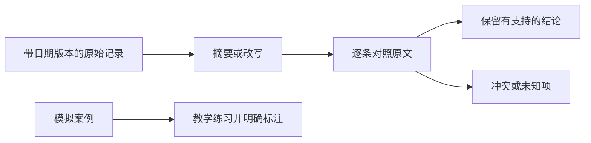

AI 生成的文字可以帮助整理和练习，但它不能仅凭语言流畅就成为某件事真实发生的证据。原始记录、从记录提取的摘要和为了教学构造的案例，应该有不同的用途和标记。

## 用同一份会议材料分清三层

原始记录写着“提纲完成，正文未提交”。AI 生成“报告已完成”的总结，不能改变原始记录；另一个AI再根据总结写出“项目按时交付”，也没有增加独立证据。这个例子由作者设计，展示的是信息如何在转述中改变。

原始材料还要检查来源、日期和版本。模型输出若附了链接，应打开链接，确认原文是否支持当前说法；真实网页存在并不代表所引结论正确。

## 为什么生成数据仍然有用

Self-Instruct 研究把模型生成的指令和答案经过筛选后用于训练，说明生成材料有特定用途。它没有证明这些答案可以作为外部世界事实的原始记录。摘要忠实性研究也提示，改写可能引入输入不支持的内容。

## 哪些情况要退回原文

数字、否定、批准状态、负责人和期限都应回到原始位置检查。“拟提交”不能改成“已提交”，“尚未批准”不能写成“原则上通过”。模型自行生成的截图描述、书目或统计也不能当作核验结果。

两个生成回答一致，可能只是共享训练信息或使用了同一段摘要，不能直接算作两份独立来源。应寻找不同的原始记录或可重复的测量，而不是增加模型投票次数。

## 一个可执行的整理方法

保留原文编号与版本，为每个重要结论列出原文位置、支持范围和状态。生成摘要时要求“不新增事实；缺失项写未提供”。交付摘要同时保留证据索引，方便别人回查。

模拟数字可以用于演示，但要在材料和结果两处标注；不能随后删掉标记放进真实项目报告。用于正式决策时，还需按任务要求进一步审核。

## 自查练习

把“计划下周完成，负责人未定”改写成一句简短进度说明。检查是否保留了计划性质和负责人未知。若只剩“下周完成”，就丢失了影响行动的限制条件。

## 分享摘要

生成文字是待核对的派生材料。它可以帮你组织信息和设计练习，事实证据仍应来自可追溯原文、记录或测量；多个AI互相赞同不能替代这些依据。

## 相关阅读

- [[多份资料怎样比较而不混用版本]]
- [[长文摘要怎样保留关键信息]]

## 来源与核验

核对日期：2026-10-09。来源支持范围见下列说明；本文解释与教学例不构成论文复现或产品实测。

- [Self-Instruct: Aligning Language Models with Self-Generated Instructions](https://arxiv.org/abs/2212.10560)：2022年初稿、2023年v2；生成指令、输入和答案，过滤后用于微调。
- [On Faithfulness and Factuality in Abstractive Summarization](https://arxiv.org/abs/2005.00661)：2020年；抽象摘要可能包含输入不支持的内容。
