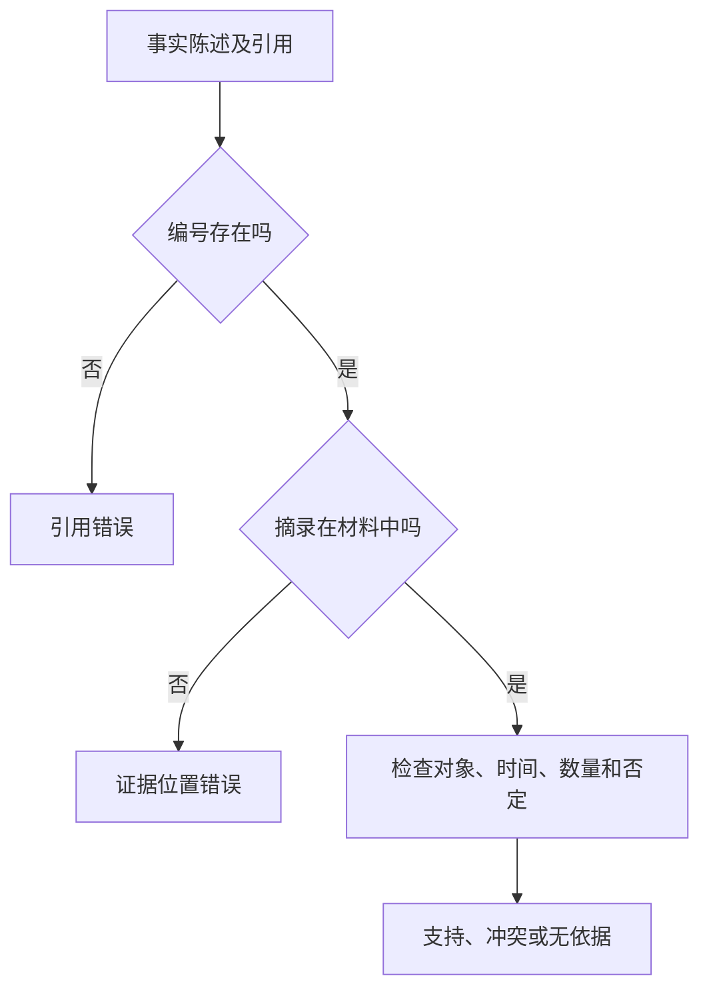

检查引用需要三层判断：编号存在吗，摘录真的在材料中吗，材料支持整句话吗。前两层可以部分自动化，第三层需要理解对象、时间、否定和完成状态。

## 将一段回答拆成可判定单元

教学材料D1写“12条需求中8条已归类，4条待确认”。“收集12条需求”和“完成全部归类”是不同陈述，不能因为它们引用同一个编号就判成相同结果。

| 判定 | 示例 | 处理 |
|---|---|---|
| 支持 | 8条已归类〔D1〕 | 保留 |
| 冲突 | 全部12条已归类〔D1〕 | 修正 |
| 无依据 | 客户满意度提高〔D1〕 | 待补证据 |
| 引用错误 | 正确事实写成引用D99 | 修正编号并核对来源 |

“无依据”是相对于当前材料的判定，不能直接改成“现实中一定错误”。[On Faithfulness and Factuality in Abstractive Summarization](https://arxiv.org/abs/2005.00661) 区分摘要与输入的一致性；[SummEval: Re-evaluating Summarization Evaluation](https://arxiv.org/abs/2007.12626) 说明评价还要区分多个维度，流畅性不能替代事实性。

## 离线脚本做什么

同一专题下 `examples/check_claims.py` 读取 `office_materials.json` 与 `claims.json`。它只判断资料编号存在、证据摘录是不是该资料的子串，同时展示预先编写的人工参考标签。输出字段 `human_reference` 来自教学标注，不是程序推理所得。

```powershell
python "08-Projects-Lab_前沿实战与实验工程/AI办公实践/examples/check_claims.py"
```

你应能看到一个尤其重要的反例：“全部12条已归类”引用D1并摘录“8条已归类”。摘录检查通过，但人工参考为冲突。这个反例证明基础格式检查不能代替语义审核。



## 评测口径怎样记录

先定义陈述单位，再标注支持、冲突、无依据和不可判定。资料版本改变后，旧标签不应无条件沿用。若要报告“支持率”，分母应明确为哪些可判定陈述；没有来源但现实正确的回答，仍可能不满足“仅根据材料”的任务要求。

本例只有几条作者设计的样本，目的在于展示失败类型，不代表某款模型整体质量。需要扩大评测时，固定一批任务、保存模型与提示版本，增加复核与仲裁，观察同一任务的回归变化。

使用模型裁判可以扩大覆盖，但还要用人工标注子集检查偏差。格式验证结果、人工作出的语义标签和模型裁判结果应分别保存，避免把任何一个自动分数直接当作事实证明。

## 分享摘要

引用存在、摘录匹配与结论被支持，是三件事。基础脚本能检查前两项，却可能放过带真实引用的错误结论；评测必须保留语义标签、材料版本和明确分母。

## 相关阅读

- [[AI为什么会编造答案]]
- [[一个最小检索增强问答流程如何工作]]
- [[怎样让AI根据资料回答并标出依据]]

## 来源与核验

查询日期：2026-10-06。下列资料支持基础机制和方法；本文任务材料、提示词与参考答案为作者编写的教学演示。论文结论仅对应其被测任务与模型。

- [On Faithfulness and Factuality in Abstractive Summarization](https://arxiv.org/abs/2005.00661)：ACL 2020原始论文；摘要可能产生与输入不一致的内容。
- [SummEval: Re-evaluating Summarization Evaluation](https://arxiv.org/abs/2007.12626)：2020年SummEval论文；摘要评价区分一致性、相关性、流畅性与连贯性。
