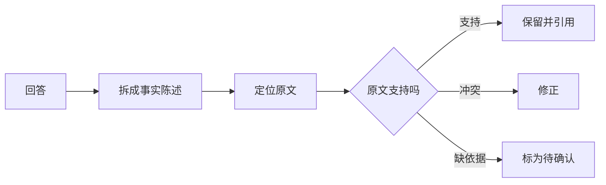

AI 会给出流畅但缺乏依据的回答。使用时最容易踩的坑，是把“说得像真的”当成“已经查证”。判断一个答案，首先看它的结论能否回到具体材料。

## 从一个容易忽略的错误开始

以下是模拟教学材料：一份记录写着“周一收集了 12 条需求，其中 8 条已归类，4 条待确认”。如果摘要变成“本周完成全部需求整理，客户满意度明显提升”，它至少发生了两处变化：把部分完成改成全部完成，又加入原文没有的满意度结论。

前半句和后半句都很像工作报告，问题却不同。前者与材料冲突，后者没有依据。即使语言更漂亮，这两项也不能直接进入正式总结。

## 为什么会发生

以自回归语言模型为例，它学习的是如何根据上下文继续生成文本。[Language Models are Few-Shot Learners](https://arxiv.org/abs/2005.14165) 展示了预训练与文本示例带来的任务能力；这种能力本身没有给每一句话附上事实证明。

问题资料不完整、训练中没有可靠覆盖、检索到的片段不对，或者任务要求过于含糊，都可能让输出偏离证据。这些是排查方向，不能凭一个错误倒推出模型内部发生了哪种机制。

[On Faithfulness and Factuality in Abstractive Summarization](https://arxiv.org/abs/2005.00661) 研究的是摘要与输入之间的一致性，说明语言流畅与忠实于材料需要分别评估。它不能用来给今天任意一款产品指定统一“幻觉率”。

## 一个可执行的检查顺序

1. 圈出会影响决定的事实：人物、数量、日期、金额、因果和承诺。
2. 对每项事实找原文片段，确认对象、范围与时间一致。
3. 标成“支持”“冲突”或“材料不足”；材料不足不自动等于现实中错误。
4. 让 AI 修改冲突内容，把不足部分改为待确认，然后再次检查。

可以这样下达任务：“只使用以下材料；没有写出的结论请说材料未提供；涉及数字和完成状态时逐项引用原文。”这能明确检查目标，不能保证从此没有错误。

## 哪些情况下需要更严格

财务、合同、健康等重要决定需要相应专业人员复核。要求另一个 AI 同意原答案，也不能替代原始证据；两个系统可能重复同一种错误。最实用的习惯，是把 AI 当作帮助整理与定位的助手，再根据材料做判断。

## 分享摘要

AI 回答得自然，不代表事实已经核对。把答案拆成人物、数字、日期和完成状态，逐项找原文；没有依据的结论保留为待确认，往往比再问一句“你确定吗”更有帮助。

## 相关阅读

- [[怎样让AI根据资料回答并标出依据]]
- [[如何检查AI回答的事实和引用]]

## 来源与核验

查询日期：2026-10-06。下列资料支持基础机制和方法；本文任务材料、提示词与参考答案为作者编写的教学演示。论文结论仅对应其被测任务与模型。

- [Language Models are Few-Shot Learners](https://arxiv.org/abs/2005.14165)：2020年原始论文；预训练语言模型与文本中的任务示例，不等同于验证事实。
- [On Faithfulness and Factuality in Abstractive Summarization](https://arxiv.org/abs/2005.00661)：ACL 2020原始论文；摘要可能产生与输入不一致的内容。
