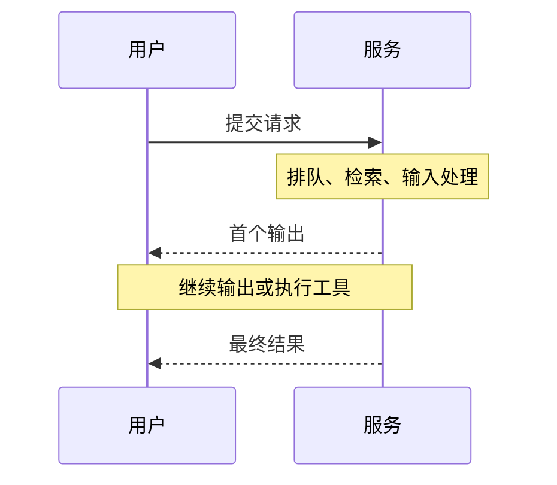

“速度快”必须先说明测量对象。用户等待首个输出、收到完整答案，以及服务器每秒完成多少工作，是不同指标；费用还需要明确输入、输出和其他计费项。

## 先区分四个口径

| 指标 | 想了解什么 | 容易混淆的地方 |
|---|---|---|
| 首字或首Token延迟 | 从请求到首个输出需要多久 | 不等于整个任务时间 |
| 端到端耗时 | 完整任务什么时候结束 | 包含检索、排队和工具调用等环节 |
| 输出速度 | 输出阶段产生Token的速度 | 分母与流式事件需要说明 |
| 吞吐 | 一段时间处理的请求或Token总量 | 需同时说明并发与失败请求 |

[vLLM v0.31.0 Metrics](https://docs.vllm.ai/en/v0.31.0/design/metrics/) 使用不同指标记录服务过程，尤其区分流式输出事件间隔与请求级平均Token时间。本文只解释口径，未安装或运行该版本服务。



## 一个模拟费用计算

假设输入1000 Token，输出200 Token；输入单价每百万Token 2元，输出单价每百万Token 8元。两项合计为0.0036元。单价和数量都是作者设定的教学数字，不是任何服务商当前报价。

`AI办公实践/examples/metrics_demo.py` 实际运行这一计算，同时对三条模拟首字延迟计算最近秩法P95。

```powershell
python "08-Projects-Lab_前沿实战与实验工程/AI办公实践/examples/metrics_demo.py"
```

三条延迟样本为0.4、0.6、1.2秒，示例P95为1.2秒。样本极少，只说明算法，不能代表服务稳定性。实际报价还可能包含缓存、推理、搜索、图片、工具及重试等项目，需要查供应商规则。

## 真实比较需要固定什么

固定任务集合、模型版本、硬件或服务配置、并发、输入输出长度及是否启用工具。记录成功与失败、质量变化和复核成本。[Holistic Evaluation of Language Models](https://arxiv.org/abs/2211.09110) 强调评价需要多个场景和维度，所以不能只以Token速度替代任务效果。

如果更快的系统漏掉关键事实，就可能把时间转移到人工修改上。除了平均值，还应看尾部延迟、异常率和质量回归。每份报告都应说明测量边界、样本数和统计方法。

本轮只执行离线算术示例，没有服务器压测或模型API调用，不报告真实吞吐、性能提升或实际使用费用。

## 分享摘要

推理性能先说明口径：首字延迟、整体耗时、输出速度和吞吐不能互换。费用计算要区分计费项；模拟数字用于教学，不能当作当前报价或真实压测结果。

## 相关阅读

- [[怎样理解模型排行榜]]
- [[如何检查AI回答的事实和引用]]

## 来源与核验

查询日期：2026-10-06。下列资料支持基础机制和方法；本文任务材料、提示词与参考答案为作者编写的教学演示。论文结论仅对应其被测任务与模型。

- [vLLM v0.31.0 Metrics](https://docs.vllm.ai/en/v0.31.0/design/metrics/)：官方版本化文档；TTFT、端到端延迟与流式事件间隔的指标口径。
- [Holistic Evaluation of Language Models](https://arxiv.org/abs/2211.09110)：2022年HELM论文；模型评价需多个场景和维度。
