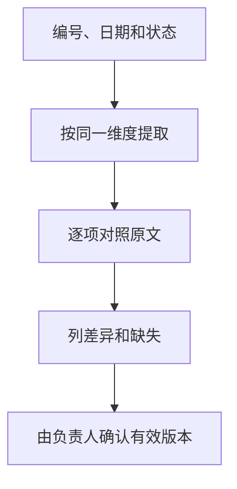

让AI比较资料时，先给每份材料一个稳定编号，保留日期和状态。两段内容不同，首先表示存在差异，并不自动说明较新的一段已经批准。

## 输入：两份模拟计划

| 编号 | 日期与状态 | 内容 |
|---|---|---|
| A | 10月1日，草案 | 周五提交报告提纲，负责人甲 |
| B | 10月3日，待确认 | 周五提交报告正文，负责人未定 |

这些是教学材料。“草案”和“待确认”都不能直接作为正式任务承诺。

## 可用提示词

```text
比较A与B的任务对象、交付物、负责人和状态。
每一行分别写A原文、B原文、差异及需要确认的事项。
不要把日期较新当作已经生效，不要自行合并成正式计划。
遇到材料未写出的内容，标“未提供”。
```

[Claude prompting best practices](https://platform.claude.com/docs/en/build-with-claude/prompt-engineering/claude-prompting-best-practices) 支持把任务与输出结构说明清楚；[Retrieval-Augmented Generation for Knowledge-Intensive NLP Tasks](https://arxiv.org/abs/2005.11401) 提供检索外部材料后生成的研究路径。具体版本生效规则仍由资料管理制度决定，不由模型推测。

## 参考结果

| 比较项 | A | B | 差异与待确认 |
|---|---|---|---|
| 交付物 | 报告提纲 | 报告正文 | 范围扩大，需确认是否批准 |
| 提交时间 | 周五 | 周五 | 表面一致；还需确认对应哪一周 |
| 负责人 | 甲 | 未定 | 不能把甲自动沿用到B |
| 状态 | 草案 | 待确认 | 均不能认定正式生效 |

参考表由作者编写，不是产品实测。它保留冲突，而不是为了生成一个整齐答案而消除冲突。



## 常见失误

表格两列用了不同对象、把旧版的负责人带入新版、把预计日期改成确定日期，都会让“比较”悄悄变成“编排”。资料中同名项目也可能属于不同范围，要先确认比较对象一致。

材料很多时，先筛出与问题相关的版本，再做逐项比较。最终交付应包含差异表和原文位置，而不只是“新版更完善”。如果无法找到审批记录，就写有效版本待确认，并把确认问题交给维护者。

## 增加批准与撤回记录后怎样处理

继续使用作者构造的教学材料：C为10月4日的通知，“批准仅提交提纲，负责人乙”；D为10月5日的通知，“撤回C，等待新的确认”。此时C虽然曾批准，也不能继续作为当前有效版本。A、B仍没有获得正式生效证据。

| 材料 | 原文位置 | 记录的状态 | 能否作为当前承诺 |
|---|---|---|---|
| C | 第1段 | 曾批准提纲、负责人乙 | 被D撤回，不能沿用 |
| D | 第1段 | 撤回C并等待确认 | 只能据此说明当前待确认 |

交付时写“当前有效计划未提供；C已被D撤回”，并保留C、D原文位置。不能为了合并表格，取C的负责人、B的正文范围和A的日期拼出一个新计划。

## 一次比较的最低交付物

保留参与比较的文件编号、版本、相同的比较维度、冲突项与原文位置。把确认问题交给资料负责人；模型输出不能自行批准某一版本。这个例子演示资料管理逻辑，不代表特定产品已经实测具备版本治理功能。

## 分享摘要

多份资料比较，要固定编号、日期和状态，按相同维度列原文差异。较新不等于生效；负责人、期限和审批状态不能自动从旧版继承。

## 相关阅读

- [[怎样让AI根据资料回答并标出依据]]
- [[上下文与长期记忆有什么区别]]

## 来源与核验

查询日期：2026-10-09。下列资料支持基础机制和方法；本文任务材料、提示词与参考答案为作者编写的教学演示。论文结论仅对应其被测任务与模型。

- [Retrieval-Augmented Generation for Knowledge-Intensive NLP Tasks](https://arxiv.org/abs/2005.11401)：2020年原始论文；检索外部知识与生成结合，不保证所有回答正确。
- [Claude prompting best practices](https://platform.claude.com/docs/en/build-with-claude/prompt-engineering/claude-prompting-best-practices)：Anthropic官方指导；明确任务、输入结构、示例与输出约束。其他模型应自行验证。
