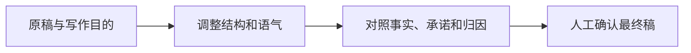

润色邮件应当改善表达，同时保留原有事实与承诺。最危险的改动往往很小：把“预计”删掉，把“希望确认”改成“已确认”，或者为了礼貌新增一个没有同意的截止日期。

## 模拟原稿

> 报告提纲写好了，正文还没送审。剩下4条需求没确认。想问一下下周安排，负责人和具体时间还不知道。

写给负责协调的同事，希望获得下一步安排。原稿没有承诺交付日期，也没有真实收件人。

## 给AI的约束

```text
把这段文字改成简洁礼貌的工作邮件。
保留“提纲完成、正文未送审、4条需求待确认”。
目的为请求确认下一步安排。
不要新增完成承诺、日期、人员评价或道歉原因。
另外列出修改说明，不要自动发送。
```

参考邮件由作者编写：

> 主题：请确认资料整理的下一步安排
>
> 目前报告提纲已完成，正文尚未提交审核，另有4条需求待确认。请协助明确下一步负责人及时间安排，以便继续推进。谢谢。

措辞更有条理，但没有把未知信息变成承诺。

## 改动怎样核对

| 改动 | 可以接受吗 | 原因 |
|---|---|---|
| “写好了”改为“已完成” | 可以 | 对象仍然是提纲 |
| “正文还没送审”改为“正文尚未提交审核” | 可以 | 状态一致 |
| 加入“周五前一定提交” | 不可以直接接受 | 新增了承诺 |
| 加入“因对方拖延” | 不可以直接接受 | 新增了归因 |



[Claude prompting best practices](https://platform.claude.com/docs/en/build-with-claude/prompt-engineering/claude-prompting-best-practices) 支持明确目标、语气和输出约束；[Documents — Technical Writing](https://developers.google.com/tech-writing/one/documents) 强调文档读者与组织。具体礼貌程度取决于关系和情境，不能让模型擅自判断你应承担什么责任。

## 正式发送前

核对收件人、附件、主题和链接，再读一遍所有日期、金额、保证、责任归属与敏感信息。自动发送与润色是两项操作，本例只提供草稿。

如果你需要更正式的版本，可以要求减少口语和冗余，但仍保留相同事实。重要沟通最好把原稿、改稿和修改理由一起保存，后续发生争议时能说明哪里被改过。

## 分享摘要

AI 润色邮件时，要锁定事实、完成状态和承诺。语气可以更清楚，责任和截止日期不能自动新增；保留改动对照，再人工确认收件人与附件。

## 相关阅读

- [[资料脱敏与结果复核]]
- [[零散记录转行动清单]]

## 来源与核验

查询日期：2026-10-06。下列资料支持基础机制和方法；本文任务材料、提示词与参考答案为作者编写的教学演示。论文结论仅对应其被测任务与模型。

- [Claude prompting best practices](https://platform.claude.com/docs/en/build-with-claude/prompt-engineering/claude-prompting-best-practices)：Anthropic官方指导；明确任务、输入结构、示例与输出约束。其他模型应自行验证。
- [Documents — Technical Writing](https://developers.google.com/tech-writing/one/documents)：Google技术写作课程；明确受众、组织范围与文档大纲。
