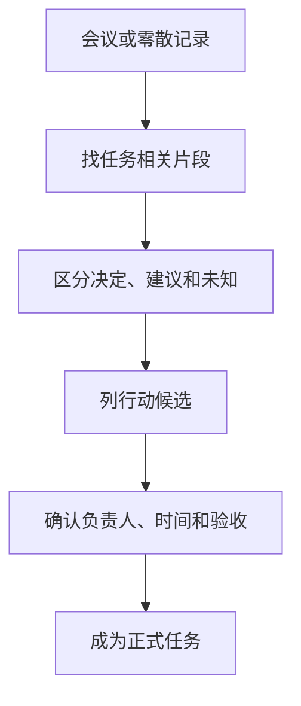

行动清单需要说清任务、负责人、时间和验收方式。会议里提到过某件事，并不意味着已经决定执行；缺少的信息必须保留为待确认。

## 模拟输入

> 讨论到剩余4条需求需要确认；有人建议甲跟进，但甲未确认。下周再讨论。报告正文尚未送审，提纲已完成。是否增加图表暂未决定。

这段没有真实人员，甲只是教学代称。目标是整理行动候选，不是发出任务指令。

## 提示词与参考清单

```text
从记录中提取行动候选。
分别标注：明确决定、建议、待确认。
字段为任务、负责人、期限、验收方式、依据。
没有明确的信息写“待确认”；不要把“有人建议”改成“已安排”。
```

| 行动候选 | 性质 | 负责人 | 期限 | 验收方式 |
|---|---|---|---|---|
| 确认剩余4条需求 | 需要跟进，安排未定 | 待确认，甲仅被建议 | 待确认 | 每条需求有确认结论 |
| 完成正文并送审 | 未完成事项 | 待确认 | 待确认 | 形成送审稿及记录 |
| 增加图表 | 未决定 | 待确认 | 待确认 | 先确认是否需要 |

“每条需求有确认结论”和“形成送审稿及记录”是作者提出的验收建议，不是会议已经批准的标准。参考清单将建议与事实分开保存。



[QMSum: A New Benchmark for Query-based Multi-domain Meeting Summarization](https://arxiv.org/abs/2104.05938) 研究问题导向的会议摘要和相关片段定位；[Claude prompting best practices](https://platform.claude.com/docs/en/build-with-claude/prompt-engineering/claude-prompting-best-practices) 提供明确结构与约束的方法。两者没有授权系统代替参与者作出任务承诺。

## 如何复核

重点检查“计划”“建议”“同意”“未定”等词是否保留。姓名出现的位置是否真的说明负责，而不是发言人或被提及者？“下周讨论”是否被错误转换为“下周完成”？

清单还应保留原文位置，避免同事需要重新翻遍记录。下一次确认后再更新负责人和期限，并记录修改来源。若要创建线上任务或通知他人，那是另外的实际操作，本案例只生成候选清单。

本文没有进行真实会议试用，因此不报告遗漏率或省时指标。它提供的是可核对的整理方法和显式确认步骤。

## 分享摘要

行动清单先区分决定、建议和待确认事项。负责人、期限与验收标准没有写明时不要自动补全；候选清单经过确认之后，才能成为正式任务。

## 相关阅读

- [[用AI起草工作总结从材料到复核]]
- [[报告提纲怎样围绕读者的问题]]

## 来源与核验

查询日期：2026-10-06。下列资料支持基础机制和方法；本文任务材料、提示词与参考答案为作者编写的教学演示。论文结论仅对应其被测任务与模型。

- [QMSum: A New Benchmark for Query-based Multi-domain Meeting Summarization](https://arxiv.org/abs/2104.05938)：2021年QMSum论文；问题导向的会议摘要及相关片段定位。
- [Claude prompting best practices](https://platform.claude.com/docs/en/build-with-claude/prompt-engineering/claude-prompting-best-practices)：Anthropic官方指导；明确任务、输入结构、示例与输出约束。其他模型应自行验证。
