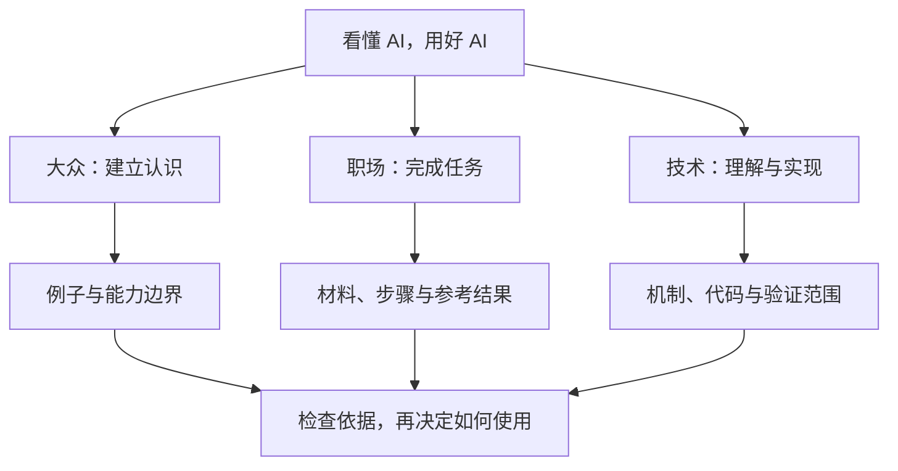

> [!SUMMARY]
> 看懂 AI，用好 AI，逐步理解背后的技术。你可以先读懂一个问题，再完成一项小任务，最后深入机制与实现。

## 从适合你的入口开始

| 你希望获得什么 | 从这里开始 | 第一篇 |
|---|---|---|
| 建立认识，分清能力与宣传 | [[大众阅读路线\|大众路线]] | [[AI机器学习与大模型是什么关系]] |
| 整理资料、起草文字并检查结果 | [[职场阅读路线\|职场路线]] | [[怎样让AI根据资料回答并标出依据]] |
| 理解检索、评测、权限与性能 | [[技术阅读路线\|技术路线]] | [[一个最小检索增强问答流程如何工作]] |

## 先读这六篇

- [[AI为什么会编造答案]]：流畅的回答为什么仍需证据。
- [[AI聊天助手与智能体有什么区别]]：给建议与执行动作差在哪里。
- [[怎样让AI根据资料回答并标出依据]]：用三条材料练习可核对的问答。
- [[用AI起草工作总结从材料到复核]]：从原始记录到事实表和成稿。
- [[一个最小检索增强问答流程如何工作]]：实际运行离线词项检索，观察提示词怎样组装。
- [[如何检查AI回答的事实和引用]]：真实引用也可能支持不了结论。

## 新增三个问题

- [[AI思考更久为什么仍然会错]]
- [[AI生成的资料能当作证据吗]]
- [[机器人看懂指令为什么仍可能做不好]]

## 怎样阅读这些内容

文章会注明来源、适用边界和验证状态。办公材料与参考结果为作者设计的教学示例；标为模拟的数字不代表真实项目成果。离线代码说明实际做了什么，未接入的模型、服务和生产环境也会明确说明。

遇到重要结论，沿着引用查看原文；涉及个人或工作资料时，先读 [[资料脱敏与结果复核]]。你可以从当前任务需要的文章开始，不必先学完全部理论。
